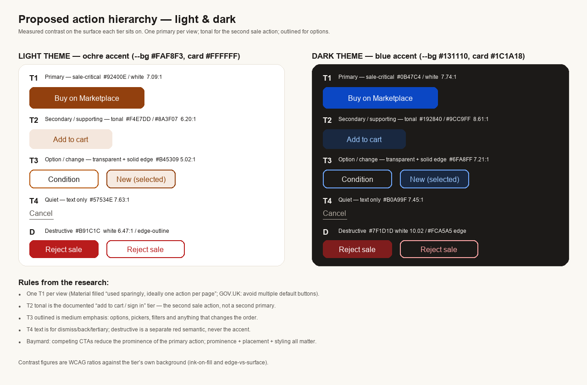

# UI action hierarchy — colour and emphasis audit (2026-11-24)

**Operator:** *"audit the buttons and options that are the same color as the background. Some buttons are blue in dark mode and some are grey. Bring variation into the mix: really important function that could lead to a sale → dark blue; less important → lighter blue; option to change something → transparent with a solid edge. Do research on what the industry does and make a suggestion."*

**Status: IMPLEMENTED 2026-11-24 — deployed `f2f4844c` (frontend-only), rollback
`alloutdoor-20261124-222218.dump`.** Option A — one accent per theme; the four-tier
tokens are live in `globals.css` (both themes), the T1 primary
fills were migrated repo-wide, T2/T3/DANGER mappings were applied to the shared
pickers and the sale-critical controls, the PWA chrome was switched to outlined
T3-neutral, the hardcoded literals were replaced, and DESIGN.md §3/§8/§11 now
carry the tier rules. Frontend typecheck clean, 186 spec files / 2,084 tests
passed, production build + theme gate clean, public smoke test 200s with no new
frontend error lines. Palette sheet below; the per-control list in §4 is what
shipped.



---

## 1. Why the buttons look inconsistent

The theme has **one accent token** (`--red`): ochre `#B45309` on the light
theme, which the dark theme swaps for blue `#0967F5`
([globals.css:138](../../frontend/app/globals.css#L138),
[globals.css:366](../../frontend/app/globals.css#L366)). So any button painted
with `var(--red)` is ochre on one theme and blue on the other, while every
button painted with `--bg-inset`/`--bg-card` stays grey. On top of that, ~192
buttons carry **hardcoded colours** in their inline styles, which do not follow
the swap at all. Live scan of the member app (`629` buttons, admin/scanner/bench
excluded):

| Fill family | Count | What it means on screen |
|---|---|---|
| ghost / icon / text-only | 373 | no chrome |
| neutral fill (`--bg-card` / `--bg-inset`) | **113** | **grey, on both themes** |
| accent fill (`var(--red)`) | 90 | ochre in light, blue in dark |
| accent outline (1px `--red`) | 22 | ochre/blue outline |
| success fill | 2 | green (both themes — fine, semantic) |
| `--info` blue outline | 2 | **blue in BOTH themes** (a second blue in dark, alien in light) |
| accent tint | 1 | ochre/blue wash |
| other | 26 | mixed literals |

So the operator is seeing exactly three populations: **blue** = accent-painted
buttons, **grey** = neutral-fill buttons, plus a few **red/amber/green** strays
from hardcoded literals and `--info`.

### Hardcoded colours that ignore the theme swap (the "strays")

| Literal | Where it appears (examples) | Effect |
|---|---|---|
| `rgba(227,6,19,0.06 / 0.08 / 0.09)` (old brand red wash) | [checkout-form.tsx:1944](../../frontend/app/checkout/[listingId]/checkout-form.tsx#L1944), [delivery-method-cards.tsx:91](../../frontend/components/delivery-method-cards.tsx#L91), [wishlist-button.tsx:99](../../frontend/components/wishlist-button.tsx#L99), [video-dropzone.tsx:179](../../frontend/components/video-dropzone.tsx#L179), [dispatch-button.tsx:483](../../frontend/app/transactions/[id]/dispatch-button.tsx#L483), [sign-up-form.tsx:1234](../../frontend/app/sign-up/[[...sign-up]]/sign-up-form.tsx#L1234) | pink/red wash in light (vs ochre accent) and red in dark (vs blue accent) |
| `rgba(245,158,11,…)` amber | [cart-delivery-picker.tsx:245](../../frontend/components/cart-delivery-picker.tsx#L245), [auction-panel.tsx:379](../../frontend/app/listings/[id]/auction-panel.tsx#L379), [checkout/complete/page.tsx:221](../../frontend/app/checkout/complete/page.tsx#L221), [seller-questions-card.tsx:587](../../frontend/app/dashboard/seller-questions-card.tsx#L587) | a third accent on a page with ochre/blue |
| `rgba(34,197,94,…)` green | [auction-panel.tsx:562](../../frontend/app/listings/[id]/auction-panel.tsx#L562), [sign-up-form.tsx:1234](../../frontend/app/sign-up/[[...sign-up]]/sign-up-form.tsx#L1234) | hardcoded green competing with `--success` |
| `#C7050F` | [sheet-footer.tsx:135](../../frontend/components/licence-centre/sheet-footer.tsx#L135) | brand-red literal |
| `#6b7280` grey | [received-offer-actions.tsx:439](../../frontend/app/offers/received/received-offer-actions.tsx#L439) | grey literal |
| `named:red` | [motivation/upload-panel.tsx:100](../../frontend/components/motivation/upload-panel.tsx#L100) | named colour |
| `var(--info)` | [received-offer-actions.tsx:298](../../frontend/app/offers/received/received-offer-actions.tsx#L298) (`Counter`) | **blue in both themes** — in dark it is a second, lighter blue next to the accent blue |
| `var(--accent, #2563eb)` | [support/page.tsx:271](../../frontend/app/support/page.tsx#L271) | blue fallback if the alias ever disappears |

### Two real bugs this exposes

1. **Destructive actions fail contrast in dark mode.** `--danger` is
   `var(--red-700)` = `#B8050F` with no dark-theme override; on the dark card
   `#1C1A18` that is **2.53:1** (needs 3:1/4.5:1). Outlined "Reject", "Decline",
   "Withdraw", "Cancel listing", "Delete" labels are hard to see in dark mode.
2. **Several views have more than one filled primary**, which is the actual
   cause of the "which one is the main thing?" feeling:
   - [licence start page](../../frontend/app/licence-centre/[id]/start/page.tsx):
     **4** accent-filled choices (`Choose Motivation letter only`, `Choose
     Print-ready pack`, `Choose Print / Download`, `Choose Print and Deliver`)
     plus another filled `Continue to the interview`.
   - [licence interview](../../frontend/app/licence-centre/[id]/interview/page.tsx):
     `Next`, `Send`, `Add now`, `Review my answers`, `Save answer` are all
     accent-filled in different states of the same screen.
   - Transactions/checkout screens mix a filled accent, a filled success, an
     accent outline and neutral greys in one stack.

### Still "same as the background" after the previous contrast pass

These controls were outside the last sweep (sheet/modal/tertiary rows) and still
have no visible chrome or only the 0.5px card hairline:

| Control | Where | Current |
|---|---|---|
| `Sign in to make an offer` | [offer-panel.tsx:260](../../frontend/app/listings/[id]/offer-panel.tsx#L260) | `--bg-inset` fill + 0.5px `--border` |
| `Ask the seller anyway` | [questions-panel.tsx:446](../../frontend/app/listings/[id]/questions-panel.tsx#L446) | transparent + 0.5px `--border` |
| `Load more` (follows sheet, liked-by sheet) | [follows-sheet.tsx:239](../../frontend/components/community/follows-sheet.tsx#L239), [liked-by-sheet.tsx:213](../../frontend/components/community/liked-by-sheet.tsx#L213) | 0.5px `--border` / bare text |
| `Remove` (wishlist, cart, cart line) | [add-to-cart-button.tsx:27](../../frontend/components/add-to-cart-button.tsx#L27), [cart/page.tsx:748](../../frontend/app/cart/page.tsx#L748), [cart/page.tsx:804](../../frontend/app/cart/page.tsx#L804) | 0.5px `--border` |
| `Report that the handover did not happen` | [a/[token]/private-arrange-action.tsx:263](../../frontend/app/a/[token]/private-arrange-action.tsx#L263) | `--bg-card` + 0.5px `--border` |
| `I can't fulfil — reject + refund buyer` | [accept-reject-panel.tsx:423](../../frontend/app/transactions/[id]/accept-reject-panel.tsx#L423) | transparent + 0.5px `--border` |
| `Delete` (settings) | [settings/page.tsx:759](../../frontend/app/settings/page.tsx#L759) | text-only grey |
| `Load more` (my posts) | [my-posts-client.tsx:363](../../frontend/components/community/my-posts-client.tsx#L363) | `--bg-card` + 0.5px `--border` |
| `Save this address to my address book` | [print-delivery.tsx:334](../../frontend/components/licence-centre/print-delivery.tsx#L334) | hairline only |
| various `Try again` | [delivery-options-picker.tsx:239](../../frontend/components/delivery-options-picker.tsx#L239), [review-screen.tsx:501](../../frontend/components/document-centre/review-screen.tsx#L501), [unplaced-upload-dialog.tsx:122](../../frontend/components/licence-centre/unplaced-upload-dialog.tsx#L122) | bare text (red text on some) |

---

## 2. What the industry does

- **Material Design 3 / Android** defines five button types by emphasis:
  *filled* (high-emphasis primary: Save, Join now, Confirm — "should be used
  sparingly, ideally for only one action on a page"), *filled tonal* ("also for
  primary or significant actions… suits functions such as **add to cart** and
  **sign in**"), *elevated*, *outlined* ("medium-emphasis… important but not the
  primary action… Cancel/Back"), *text* ("low-emphasis… Learn More, View
  details"). — [developer.android.com button component](https://developer.android.com/develop/ui/compose/components/button.md.txt)
- **GOV.UK Design System:** one *default* (primary) button per page ("Avoid
  using multiple default buttons on a single page — having more than one main
  call to action reduces their impact"), *secondary* for secondary actions,
  *warning* only for serious irreversible actions with a confirmation step — and
  "do not only rely on colour to communicate the serious nature of the action".
  Their research also found that colouring start buttons improved click-through,
  i.e. **colour placement measurably moves behaviour**. —
  [design-system.service.gov.uk button](https://design-system.service.gov.uk/components/button/)
- **Shopify Polaris:** four variants — `primary`, `secondary`, `tertiary`,
  `plain` ("plain buttons look similar to links… for less important or less
  commonly used actions"). — [Polaris Button](https://polaris-react.shopify.com/components/actions/button)
- **Baymard (e-commerce):** the primary Add to Cart/checkout action must be the
  most visually prominent element and competitors must not compete with it;
  their research finds **48% of e-commerce sites neglect at least one element
  needed to draw attention to the primary checkout button** (prominence,
  styling, placement or microcopy). —
  [Baymard Add to Cart prominence #791](https://baymard.com/guidelines/791-add-to-cart-button-prominence),
  [primary vs secondary buttons](https://baymard.com/blog/primary-secondary-buttons)

**Synthesis for All Outdoor:** four emphasis levels, one filled primary per view,
a tonal level for the *second* sale action, outlined for anything that changes
an order/option, text for dismiss/tertiary, and a separate red semantic for
destructive. This is exactly the operator's instinct, with industry names:
"dark blue" = filled primary, "lighter blue" = filled tonal, "transparent with a
solid edge" = outlined.

### Decision needed: the light theme's accent is ochre, not blue

The operator's examples assume blue. Dark mode's accent *is* blue; the light
theme's accent is ochre `#B45309` (the white/ochre shop theme, enforced by the
theme-sync gate). Recommendation (Option A, default): **keep one accent per
theme** — deep ochre/lighter ochre in light, dark blue/lighter blue in dark. If
you want blue as the accent on **both** themes (Option B), that is a brand/theme
change: it recolours every primary CTA on white, leaves the red logo untouched,
and must update the theme tokens + DESIGN.md in both places. The tier system
below works either way — only the values change.

---

## 3. Proposed system

Palette: [UI-ACTION-HIERARCHY-PALETTE-2026-11.png](UI-ACTION-HIERARCHY-PALETTE-2026-11.png)

| Tier | Role | Light theme | Dark theme | Rules |
|---|---|---|---|---|
| **T1 Primary** | Sale-critical: the one action that completes a sale/commitment | fill `#92400E`, ink `#FFF` — **7.09:1**; hover `#7C2D12` | fill `#0B47C4`, ink `#FFF` — **7.74:1**; hover `#0A3FA8` | one per view; no outline; never for options |
| **T2 Tonal** | Supporting sale action / secondary commitment | fill `#F4E7DD`, ink `#8A3F07` — **6.20:1**; hover 18% | fill `#192840`, ink `#9CC9FF` — **8.61:1**; hover 22% | "add to cart / sign in" tier; max 1–2 per view |
| **T3 Outlined** | Option / change: pickers, filters, toggles, menus, steps | transparent, 1.5px edge `#B45309` (**5.02:1**), ink `--text-primary`; selected fill `#F6EAE1` + edge `#92400E` + ink `#8A3F07` | transparent, 1.5px edge `#6FA8FF` (**7.21:1**), ink `--text-primary`; selected fill `#192840` + edge `#6FA8FF` + `#9CC9FF` | this is the operator's "transparent with solid edge"; always paired with a text label |
| **T4 Quiet** | Dismiss / back / share / tertiary links | text `#57534E` (7.63:1); accent text links `#B45309` (5.02:1) | text `#B0A99F` (7.45:1); accent text `#6FA8FF` (7.2:1) | no fill, no edge; never for required choices |
| **D Destructive** | Reject/decline/withdraw/cancel/delete/dispute | solid `#B91C1C` + white **6.47:1**; outline edge/ink `#B91C1C` | solid `#7F1D1D` + white **10.02:1**; outline edge/ink `#FCA5A5` (**9.14:1**) | separate semantic from the accent; confirm via modal; never the default action |

Token proposal (both theme blocks):

```css
--action-primary-bg / --action-primary-hover / --action-primary-ink
--action-secondary-bg / --action-secondary-hover / --action-secondary-ink
--action-option-edge / --action-option-selected-bg / --action-option-selected-edge / --action-option-selected-ink
--action-quiet-ink
--danger-bg / --danger-hover / --danger-ink / --danger-edge   /* fix the 2.53:1 dark failure */
```

**Decision tree** (what tier does a control get):
1. Does it take money or commit the sale? → **T1** (only one per view; if two
   compete, the other becomes T2).
2. Is it the second sale action or a gateway to one (add to cart, make an offer,
   counter, contact seller, alert me)? → **T2**.
3. Does it change an order detail, or select/filter/sort something? → **T3**.
4. Is it dismiss/back/navigation-only? → **T4**.
5. Can it lose the user money/goods/access? → **D**.
6. Anything already using gold (`--gold` = paid placement), green (`--success` =
   confirmation/verified) or amber (`--warning`) keeps its semantic meaning, but
   gets the matching tier *shape* (filled for a primary, outlined for an option)
   instead of a one-off literal.

**Palettes for both themes were picked so every pair passes AA**; the swatches
on the sheet include the measured ratios.

---

## 4. The list: what to change, by tier

### T1 — deep / filled (sale-critical; keep or promote)

| Control | Where | Current | Proposed |
|---|---|---|---|
| `Buy on Marketplace — R…` | listing detail | accent fill ✓ | T1 (unchanged) |
| `Continue to payment` | [cart/page.tsx:982](../../frontend/app/cart/page.tsx#L982) | accent fill ✓ | T1 |
| `Pay R…` | checkout + offer checkout | accent fill ✓ | T1 |
| `Place Bid` / `Complete checkout` | [auction-panel.tsx:562](../../frontend/app/listings/[id]/auction-panel.tsx#L562), :845 | accent fill ✓ | T1 |
| `Accept counter` / `Accept offer` | [offer-panel.tsx:680](../../frontend/app/listings/[id]/offer-panel.tsx#L680), received-offer-actions | accent fill ✓ | T1 |
| `Submit Offer` | [offer-panel.tsx:561](../../frontend/app/listings/[id]/offer-panel.tsx#L561) | accent fill ✓ | T1 |
| `Publish listing` / `Preview` | sell form | accent fill ✓ | Publish T1, Preview T2 |
| `Sell your gear` / PWA `Sell` FAB | header / tab bar | accent fill (FAB) / neutral quick action | T1 (quick action becomes T2 tonal) |
| `Accept sale` (seller), `Confirm dispatch`, `I received it` / `Release payment` | transactions | accent/success fills | T1, success stays success-fill |
| `Continue to the interview`, `Start my application` | licence/motivation | accent fill ✓ | T1 |
| Licence *purchase choices* (4 filled) | [start/page.tsx:492-606](../../frontend/app/licence-centre/[id]/start/page.tsx#L492) | **all T1 today** | one recommended pack T1; the other packs **T2 tonal**; `Continue` stays T1 |
| Interview step actions (`Next`, `Review my answers`, `Save answer`) | [interview/page.tsx](../../frontend/app/licence-centre/[id]/interview/page.tsx) | **all filled** | current-step advance = T1; secondary actions (`Add now`, `Back to current question`) = T2/T3 |

### T2 — lighter / tonal (supporting sale actions; promote from grey or demote from red)

| Control | Where | Current | Proposed |
|---|---|---|---|
| `Add to cart` | [add-to-cart-button.tsx](../../frontend/components/add-to-cart-button.tsx) | accent outline | **T2 tonal** — this is the exact Material "add to cart" example; it should not be the second filled primary |
| `Rather make an offer?` / `Make another offer` | [offer-panel.tsx:451](../../frontend/app/listings/[id]/offer-panel.tsx#L451), :426 | accent outline | T2 |
| `Counter` (seller) | [received-offer-actions.tsx:298](../../frontend/app/offers/received/received-offer-actions.tsx#L298) | **`--info` blue** | T2 tonal (kills the second blue) |
| `Send seller consent form` | [interview/page.tsx:1105](../../frontend/app/licence-centre/[id]/interview/page.tsx#L1105) | accent outline | T2 |
| `Alert me on new matches` | [save-search-button.tsx:139](../../frontend/components/save-search-button.tsx#L139) | accent fill | T2 (it is not sale-critical; today it competes with checkout) |
| `Sign in to make an offer` / `Sign in to contact seller` | [offer-panel.tsx:260](../../frontend/app/listings/[id]/offer-panel.tsx#L260), [questions-panel.tsx:289](../../frontend/app/listings/[id]/questions-panel.tsx#L289) | neutral fill / accent fill | T2 |
| `Ask the seller anyway` / Q&A `Send` | [questions-panel.tsx:446](../../frontend/app/listings/[id]/questions-panel.tsx#L446) | ghost / accent fill | T2 |
| `Renew listing`, `Boost/Feature listing` | listings controls | mixed | T2 (paid-adjacent but secondary) |
| `Save to wishlist` (non-overlay) | [wishlist-button.tsx:99](../../frontend/components/wishlist-button.tsx#L99) | hardcoded red wash | T2 (tonal ink) with T3 selected state |

### T3 — transparent + solid edge (options / change anything)

| Group | Controls | Where |
|---|---|---|
| Purchase flow pickers | category, condition, listing type, shipping method, duration, payment rail, delivery rate, saved address, quantity stepper, `Use my saved address` / `Deliver to a different address` | sell form, [payment-method-section.tsx](../../frontend/components/payment-method-section.tsx), [delivery-options-picker.tsx](../../frontend/components/delivery-options-picker.tsx), [saved-address-picker.tsx](../../frontend/components/saved-address-picker.tsx), [checkout-form.tsx](../../frontend/app/checkout/[listingId]/checkout-form.tsx) |
| Browse / filter | every chip rail (`.chip`), sort/toggle, view-mode, `Filters`, saved-search `Pause`/`Resume` | [globals.css chip](../../frontend/app/globals.css#L2031), [filter-bar.tsx](../../frontend/components/filter-bar.tsx) |
| Listing edit | `Edit these details`, `Make cover`, `Remove`, `Replace`, `Undo` | sell/edit form |
| Community / account options | notification prefs, theme + view toggles, `Show resolved`, `Load more`, `Try again` | settings, notifications, feed |
| Photo/video add | dropzone, `Photos`/`Video` pickers, rating stars | [photo-dropzone.tsx](../../frontend/components/photo-dropzone.tsx), transactions |
| Steps | wizard Back / step jump rows | [wizard-footer.tsx](../../frontend/components/wizard-footer.tsx) |

### T4 — quiet text/ghost (keep)

Cancel/dismiss/back/close, share, like/reply, `View all`, `Learn more`, header
icon buttons (cart, heart, search, back chevron), install-prompt dismissals,
`Log out`, footer links. These should stay quiet — colouring them would flatten
the hierarchy.

### D — destructive red semantic (new token; fix dark contrast)

`Reject sale` / `Decline` / `Withdraw offer` / `Cancel listing` / `Request
cancellation` / `Raise a dispute` / `Handover did not happen` / `Remove` /
`Delete` / `Close account` / `Report` — final confirmations get the **solid
danger fill**; entry/escape-hatch buttons get the **danger outline**. Today some
are `--red`/`--success`-coloured (accent) which makes a reject look like a buy.

### Strays to normalise (replace literals with the new tokens)

All rows in the "hardcoded colours" table in §1. The biggest visual offenders
are the 6 places painting the old brand-red `rgba(227,6,19,…)` wash on selected
states — in dark mode they read as red next to blue CTAs.

---

## 5. Implementation plan (when approved)

1. **Tokens first** (small): the five groups above in both theme blocks, plus a
   dark-theme `--danger` fix. No visual change on its own.
2. **Shared components**: update the primitives/pieces that already exist —
   `.chip` (selected state → short `--action-option-selected-*`), pills, pickers,
   photo dropzone, wishlist, load-more — and introduce a real `<Button
   variant="primary | tonal | outlined | quiet | destructive">` (the one at
   [components/ui/Button.tsx](../../frontend/components/ui/Button.tsx) currently
   has no call sites; making it the vocabulary is the durable fix).
3. **Screen mapping**: licence start/interview (the multi-primary screens first),
   cart/checkout, listing detail, offers, transactions.
4. **Sweep the literals** listed in §1 and delete the `--info` blue and the
   `#2563eb` fallback.
5. Verify: frontend typecheck + vitest + production build (theme-sync gate),
   then a visual pass in both themes on a phone, checkout and the sell wizard.

Estimated: tokens + primitives ≈ half a day; screen mapping + literals ≈ one
day; visual pass ≈ an hour. Nothing in this document has been implemented yet —
waiting on go-ahead and on the light-theme decision (ochre A vs blue both themes
B).
